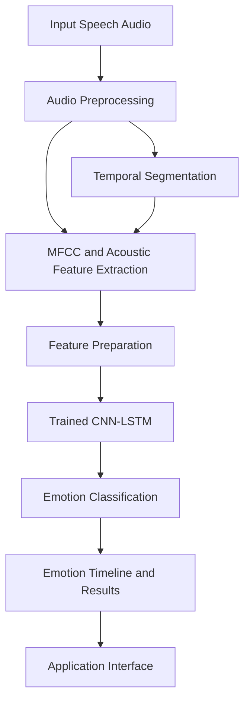

# Noise-Robust Speech Emotion Recognition Using MFCC and CNN with Temporal Emotional Analysis

An audio-based speech emotion recognition system that uses deep learning to identify emotional patterns in speech and analyze how emotions evolve over time. The project combines audio feature extraction with a trained Convolutional Neural Network (CNN) to support emotion classification and temporal emotional analysis.

**Live Demo:** [Try the Application](https://noise-robust-speech-emotion-recogni.vercel.app/)

**Repository:** [GitHub Source Code](https://github.com/lostdreamer1379-lgtm/Noise-Robust-Speech-Emotion-Recognition-using-MFCC-and-CNN-with-Temporal-Emotional-Analysis)

---

## Overview

Human speech conveys more than words. Variations in pitch, energy, spectral characteristics, and vocal patterns can provide useful information about a speaker's emotional state.

This project explores automated speech emotion recognition using audio signal processing and deep learning. It focuses on extracting meaningful acoustic representations from speech, classifying emotional content, and examining emotional changes across different portions of an audio recording.

The system includes a trained Keras model, a label encoder, and a Flask-based application for connecting the model with the user interface.

## Key Features

- **Speech emotion recognition:** Predicts an emotion category from speech audio using a trained deep learning model.
- **MFCC-based feature extraction:** Uses Mel-Frequency Cepstral Coefficients to represent important spectral characteristics of speech.
- **CNN-based classification:** Learns discriminative patterns from extracted audio features.
- **Temporal emotional analysis:** Examines emotional variation across segments of a recording rather than treating the entire recording as the only unit of analysis.
- **Noise-robust recognition objective:** Focuses on improving the reliability of emotion recognition under noisy audio conditions.
- **Flask integration:** Connects the trained model to an application interface.
- **Pretrained model support:** Includes the saved Keras model and label encoder for inference.

## System Architecture



The pipeline transforms speech audio into numerical acoustic features, passes the prepared representation to the trained model, and uses the predicted emotion labels for classification and temporal analysis.

## Methodology

### 1. Audio Preprocessing

The input speech recording is prepared for feature extraction. Consistent preprocessing is important because differences in audio representation can affect model inference.

### 2. Acoustic Feature Extraction

MFCCs provide a compact representation of the short-term spectral envelope of speech. Depending on the implemented feature pipeline, additional representations such as chroma, mel-spectrogram, and spectral contrast can capture complementary acoustic information.

### 3. Deep Learning-Based Classification

A trained CNN processes the prepared audio features and learns patterns associated with emotion categories. The saved model, `emotion_model_final.keras`, is used for prediction.

### 4. Temporal Emotional Analysis

The recording can be analyzed across temporal segments to examine changes in predicted emotional categories. This supports a timeline-oriented interpretation of vocal emotion rather than relying exclusively on a single recording-level label.

### 5. Application Integration

The Flask application connects the inference workflow with the application interface. The label encoder, `label_encoder.pkl`, supports mapping between encoded model outputs and their corresponding emotion labels.

## Technology Stack

| Component | Technology |
|---|---|
| Programming language | Python |
| Deep learning | TensorFlow / Keras |
| Audio processing | MFCC and acoustic feature extraction |
| Classification | Convolutional Neural Network (CNN) |
| Backend | Flask |
| Model format | Keras (`.keras`) |
| Label mapping | Pickle |
| Frontend assets | HTML, CSS, JavaScript |

*The exact libraries and versions should be confirmed against the project's dependency file or Python imports.*

## Repository Structure

```text
Noise-Robust-Speech-Emotion-Recognition-using-MFCC-and-CNN-with-Temporal-Emotional-Analysis/
│
├── app.py
├── emotion_model_final.keras
├── label_encoder.pkl
├── static/
├── templates/
├── uploads/
└── README.md
```

- `app.py` — Flask application and model-inference integration.
- `emotion_model_final.keras` — Saved trained emotion recognition model.
- `label_encoder.pkl` — Encoded-label mapping used by the prediction pipeline.
- `static/` — Static frontend assets.
- `templates/` — HTML templates for the web interface.
- `uploads/` — Directory associated with uploaded files; avoid committing private or unnecessary audio recordings.

## Getting Started

### Prerequisites

- Python 3.10 or another Python version compatible with the project's dependencies.
- `pip`
- Git

### 1. Clone the Repository

```bash
git clone https://github.com/lostdreamer1379-lgtm/Noise-Robust-Speech-Emotion-Recognition-using-MFCC-and-CNN-with-Temporal-Emotional-Analysis.git

cd Noise-Robust-Speech-Emotion-Recognition-using-MFCC-and-CNN-with-Temporal-Emotional-Analysis
```

### 2. Create a Virtual Environment

**Windows**

```bash
python -m venv venv
venv\Scripts\activate
```

**Linux / macOS**

```bash
python3 -m venv venv
source venv/bin/activate
```

### 3. Install Dependencies

If the repository contains a `requirements.txt` file, install its dependencies:

```bash
pip install -r requirements.txt
```

Otherwise, inspect the imports in `app.py` and install the required packages with compatible versions. Typical dependencies for this type of application may include Flask, TensorFlow, NumPy, and audio-processing libraries.

### 4. Run the Application

```bash
python app.py
```

Open the local address printed by Flask in your browser. The exact port and route depend on the application's configuration.

**Note:** Successful inference requires the model file, label encoder, and feature-extraction pipeline to be compatible with one another.

## Model Evaluation

The project was developed to investigate noise-robust speech emotion recognition and temporal emotion analysis. Reported validation accuracy has been approximately 90% during development.

This figure should be interpreted in the context of the dataset, train-validation split, class distribution, and evaluation procedure. It should not be interpreted as a guaranteed real-world accuracy or as evidence of noise robustness unless tested on appropriately noisy, independent recordings.

For a research-grade evaluation, consider reporting:

- Accuracy, precision, recall, and macro F1-score.
- Confusion matrix and per-emotion performance.
- Evaluation on clean and noise-corrupted speech.
- Performance across different noise levels and noise types.
- Temporal consistency across adjacent audio segments.
- Generalization to speakers or recordings not used during training.

## Applications

Potential applications include:

- Human-computer interaction.
- Emotion-aware voice interfaces.
- Speech analytics and affective computing research.
- Analysis of emotional variation in spoken recordings.
- Research into speech recognition systems operating under noisy conditions.

Predicted emotions are estimates derived from vocal characteristics and should not be treated as definitive measurements of a person's internal emotional state.

## Limitations

- Prediction quality depends on recording quality, background noise, speaker variation, and the training data.
- Emotion labels may not fully represent complex or mixed emotional states.
- Temporal predictions can fluctuate between adjacent segments.
- Performance claims require reproducible evaluation on independent data.
- The model's supported emotion classes and accepted audio formats depend on the implemented inference pipeline.

## Future Improvements

- Evaluate robustness under controlled noise conditions.
- Compare CNN-based classification with CNN-LSTM and other temporal models.
- Add confidence scores and more detailed segment-level visualizations.
- Improve generalization across speakers, accents, and recording environments.
- Establish reproducible evaluation protocols and document dataset provenance.
- Optimize inference latency for interactive applications.

## Research Context

This project combines acoustic feature engineering, deep learning, and temporal analysis to investigate speech emotion recognition in practical audio environments. Its emphasis is on examining emotional variation over time while addressing the challenges associated with noisy speech recordings.

## Author

**Aditya Nayak**

GitHub: [@lostdreamer1379-lgtm](https://github.com/lostdreamer1379-lgtm)

## License

No license has been specified here. Add an appropriate open-source license to the repository before permitting others to reuse, modify, or distribute the code.

---

*If you use this project for academic work, cite the associated research publication where applicable and document the dataset, feature configuration, model architecture, and evaluation protocol used in your experiments.*
